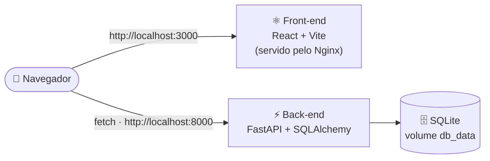
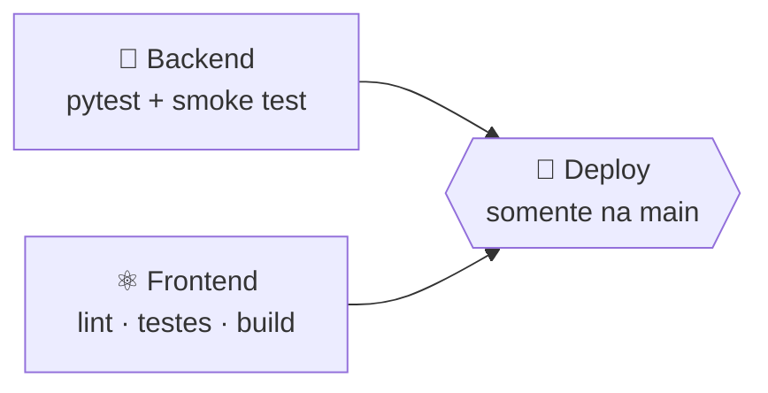

<div align="center">

# 🧑‍🤝‍🧑 Nomes & Idades

**Cadastre nomes e datas de nascimento — o backend calcula a idade.**
CRUD completo, testes automatizados e tudo rodando com um único comando.

<p>
  <a href="https://github.com/SEU_USUARIO/SEU_REPO/actions/workflows/ci.yml"></a>
  
  
  
</p>

<p>
  
  
  
  
</p>
<p>
  
  
  
  
</p>
<p>
  
  
  
</p>


</div>

---

## ✨ Visão geral

| | |
|---|---|
| 👤 **Nomes** | cadastrar, listar, consultar, editar e excluir |
| 🎂 **Idades** | o usuário informa a **data de nascimento** e o backend calcula a **idade** |
| 🧪 **Qualidade** | desenvolvido com TDD · 38 testes no backend · 14 testes de integração no front |
| 🐳 **Docker** | `docker compose up --build` e pronto |
| 🤖 **CI/CD** | pipeline no GitHub Actions: testes, lint, build e deploy |

## 🏗️ Arquitetura



## 🚀 Início rápido (Docker)

Pré-requisito: [Docker](https://docs.docker.com/get-docker/) com Docker Compose.

```bash
docker compose up --build
```

| Serviço | URL |
|---|---|
| 🖥️ Aplicação (front-end) | http://localhost:3000 |
| ⚡ API | http://localhost:8000 |
| 📖 Documentação interativa (Swagger) | http://localhost:8000/docs |

Os dados ficam no volume `db_data` e **sobrevivem** a `docker compose down`.
Para apagar tudo, inclusive o banco: `docker compose down -v`.

## 🛠️ Rodando sem Docker

<details>
<summary><b>Clique para expandir</b></summary>

**Back-end** (Python 3.12+)

```bash
cd back
python -m venv .venv
.venv\Scripts\activate          # Linux/macOS: source .venv/bin/activate
pip install -r requirements.txt
uvicorn main:app --reload
```

**Front-end** (Node 22+), em outro terminal:

```bash
cd front
npm install
npm run dev
```

Detalhes em [`back/README.md`](back/README.md) e [`front/README.md`](front/README.md).

</details>

## 🧪 Testes

```bash
# back-end
cd back && python -m pytest

# front-end
cd front && npm test
```

## 🔄 CI/CD

O workflow [`.github/workflows/ci.yml`](.github/workflows/ci.yml) roda a cada Pull Request e a cada push na `main`:



> [!NOTE]
> O passo de deploy é um modelo: troque-o pelo seu destino de publicação.
> Para ativar o badge de CI no topo, substitua `SEU_USUARIO/SEU_REPO` pelo caminho do seu repositório.

## 📁 Estrutura do projeto

```text
.
├── 📄 docker-compose.yml
├── 📂 .github/workflows/
│   └── ci.yml
├── 📂 back/                 ⚡ API FastAPI
│   ├── main.py
│   ├── database.py
│   ├── name_routes.py
│   ├── age_routes.py
│   ├── tests/
│   └── Dockerfile
└── 📂 front/                ⚛️ Interface React
    ├── src/
    │   ├── App.tsx
    │   └── App.integration.test.tsx
    ├── nginx.conf
    └── Dockerfile
```

## 🔌 Resumo da API

| Recurso | Endpoints |
|---|---|
| 👤 **Nomes** | `GET /names` · `GET /names/{id}` · `POST /names` · `PUT /names/{id}` · `DELETE /names/{id}` |
| 🎂 **Idades** | `GET /ages` · `GET /ages/{id}` · `POST /ages` · `PUT /ages/{id}` · `DELETE /ages/{id}` |

Referência completa em [`back/README.md`](back/README.md).
